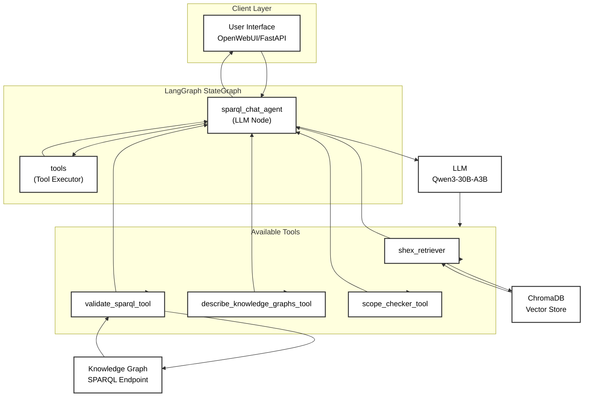

# Agent Architecture

## Agent Flow

1. **User Query**: Natural language question from client (OpenWebUI or FastAPI)
2. **LLM Invocation**: `sparql_chat_agent` node invokes the LLM with system prompt (ShEx prefixes, instructions)
3. **Tool Decision**: LLM decides whether to call a tool based on the query
4. **Tool Execution**: If tools are needed:
  - **shex_retriever**: Queries ChromaDB vector store for relevant ShEx schema chunks
  - **validate_sparql_tool**: Executes generated SPARQL query against the endpoint
  - **describe_knowledge_graphs_tool**: Lists available knowledge graphs
  - **scope_checker_tool**: Determines which KG is relevant to the query
5. **Loop**: After tool execution, returns to LLM node (LangGraph conditional edges via `tools_condition`)
6. **Response**: Final response sent back to client

## Key Components

| Component          | Description                                                        |
| ------------------ | ------------------------------------------------------------------ |
| **StateGraph**     | LangGraph state machine with `sparql_chat_agent` and `tools` nodes |
| **InMemorySaver**  | Checkpointer for conversation state                                |
| **ToolNode**       | Executes LangChain tools and returns results                       |
| **ChromaDB**       | Persistent vector store for ShEx schema embeddings                 |
| **System Prompts** | Instructions for ShEx-to-SPARQL mapping, prefix handling           |

